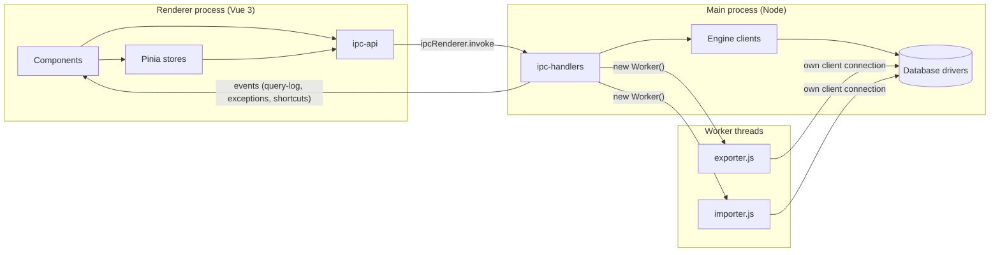

# Architecture

How Antares SQL is put together: processes, layers, and the paths data takes through them.
For commands, conventions and gotchas see [AGENTS.md](AGENTS.md); for UI guidelines see [DESIGN.md](DESIGN.md).

## Bird's-eye view

Antares is an Electron app with three kinds of JavaScript contexts:



- **Main process** ([src/main/](src/main/)): owns every database connection, the native menu and shortcuts, file dialogs and the auto-updater. It knows nothing about the UI.
- **Renderer process** ([src/renderer/](src/renderer/)): a single Vue app in one window. It never talks to a database directly: everything goes through IPC.
- **Worker threads** ([src/main/workers/](src/main/workers/)): SQL dumps and imports, which can run for minutes and must not block the main process. Each worker opens its own client connection.
- **Common code** ([src/common/](src/common/)): types, engine customizations, data type catalogs and pure helpers shared by all three.

The renderer runs with `nodeIntegration: true` and `contextIsolation: false`, so it can `require('electron')` and Node modules (it uses `electron-store` directly for persistence). The trust boundary is therefore the window itself: the main process checks that IPC calls come from the app frame (`validateSender`).

## Main process

### Main startup

[main.ts](src/main/main.ts) takes the single-instance lock, registers all IPC handlers ([ipc-handlers/index.ts](src/main/ipc-handlers/index.ts)), builds the native menu ([ShortcutRegister.ts](src/main/libs/ShortcutRegister.ts)) and creates the window. In development the window loads the webpack dev server (`localhost:9080`), in production `dist/index.html`.

App shortcuts are **native menu accelerators**: the menu item sends an IPC event (`run-or-reload`, `open-new-tab`, `select-tab-3`, ...) to the renderer, where the component that owns the action listens for it.

### IPC layer

There is one handler module per domain (`tables`, `views`, `routines`, `schema`, `users`, ...), each receiving the shared registry of open connections:

```ts
const connections: Record<string, DatabaseClient> = {}; // keyed by connection uid
```

[handle.ts](src/main/ipc-handlers/handle.ts) wraps the handlers (a few older ones, like `raw-query` and `export`, still do the same by hand): it rejects foreign senders and turns the result into the envelope `{ status: 'success' | 'error', response }`, so exceptions never cross IPC as rejections. Handlers are thin: they pick the client by `uid` and call one method on it.

### Database layer

```text
ipc-handlers ──► DatabaseClient (contracts.ts)
                    │
                    ├─ clients/<Engine>Client.ts      introspection, queries, multi-step DDL
                    └─ db/engines/<engine>/
                          <Engine>Dialect             identifier quoting, literals
                          <Engine>Ddl                 pure CREATE/ALTER/DROP builders → SQL strings
                          <Engine>Connections         pool / single connection, tab transactions, keepalive
                          <Engine>Parsers             pure parsers of server metadata
                          index.ts                    EngineDefinition (client + exporter + importer factories)
```

- [EngineRegistry.ts](src/main/libs/db/EngineRegistry.ts) maps client codes (`mysql`, `maria`, `pg`, `sqlite`, `firebird`) to an `EngineDefinition`. It is the only place that knows which engines exist.
- [contracts.ts](src/main/libs/db/core/contracts.ts) splits the client API in two: `DatabaseClient` (what every engine has) and **capabilities** (`routines`, `schedulers`, `users`, `userTypes`, ...), optional interfaces an engine declares with `implements`. Handlers call them through `requireCapability()`, which throws `UnsupportedCapabilityError` instead of reaching a stub.
- `QueryBuilder` builds one query per instance; `QueryDialect` and the `*Ddl` classes are pure (input → SQL string), which is what the SQL snapshot tests pin.
- `SshTunnel` opens one tunnel per client, shared by the pool, the query tabs and the workers. `ConnectionLease` lends a pooled connection for `raw()` and gives it back on `release()`.

The clients are being moved piece by piece from the monolithic `clients/*Client.ts` into `db/engines/`: new code goes into the engine pieces, and `ClientsFactory.ts` is a deprecated wrapper.

### Query execution

`raw-query` (in [schema.ts](src/main/ipc-handlers/schema.ts)) runs a whole editor script: the client splits it into statements, runs them on the connection bound to the query tab (so a tab can keep a transaction open when autocommit is off), and returns one `QueryResult` per statement with rows, field metadata and foreign keys. Every executed statement is also sent to the renderer as a `query-log` event for the debug console.

### Export and import

`export` / `import-sql` start a `Worker` on `dist/exporter.js` / `dist/importer.js`. The worker gets connection params and options through `workerData`, creates its own client with the engine's exporter or importer, and posts progress messages that the handler forwards to the renderer. Workers can't load `electron`: they log with [workerLog.ts](src/main/workers/workerLog.ts).

## Renderer

### Renderer startup

[index.ts](src/renderer/index.ts) creates the Vue app with Pinia, vue-i18n, FloatingVue and the app directives (`v-mask`, `v-button`, `v-tablist`), then installs the global accessibility helpers (input modality, dropdown keyboard navigation, F6 regions, form labels) and the listeners for main process events (exceptions, query logs).

### Component tree

```text
App.vue
├─ TheTitleBar
├─ TheSettingBar                     connections sidebar (folders, drag and drop)
├─ Workspace  × every saved connection (v-show: only the selected one is visible)
│  ├─ WorkspaceEditConnectionPanel   when not connected
│  ├─ WorkspaceExploreBar            database tree
│  │  └─ WorkspaceExploreBarSchema × schema   tables, views, triggers, routines, ...
│  ├─ tab bar (Draggable) + WorkspaceTabsContext
│  └─ one component per tab, chosen by tab.type
│     ├─ WorkspaceTabQuery           QueryEditor (CodeMirror) + WorkspaceTabQueryTable
│     ├─ WorkspaceTabTable           table/view data, paginated, + WorkspaceTabQueryTable
│     ├─ WorkspaceTabNew* / WorkspaceTabProps*   create / edit tables, views, triggers, routines, ...
│     └─ WorkspaceTabSchemaDiagram
├─ WorkspaceAddConnectionPanel
├─ TheFooter, TheNotificationsBoard, TheScratchpad
└─ app-level modals (ModalSettings, ModalAllConnections, ModalExportSchema, ...)
```

Things worth knowing:

- **Workspaces and tabs stay mounted.** Switching connection or tab toggles visibility; it doesn't recreate components. This keeps editor state and results, but means components must clean up global listeners (`window`, `ipcRenderer`) in `onBeforeUnmount`, and must check `isSelected` before reacting to global shortcuts, since every mounted workspace receives them.
- **The result grid** ([WorkspaceTabQueryTable.vue](src/renderer/components/WorkspaceTabQueryTable.vue)) renders through [BaseVirtualScroll.vue](src/renderer/components/BaseVirtualScroll.vue): only the visible rows plus a margin are mounted as `WorkspaceTabQueryTableRow`, so result sets with hundreds of thousands of rows are fine as long as per-row work stays O(1) (selection lookups go through a `Set`).
- Component naming: `Base*` generic building blocks, `The*` singletons, `Modal*` dialogs, `Workspace*` per-connection UI.

### State

Pinia stores in [src/renderer/stores/](src/renderer/stores/):

| Store | Holds | Persisted in (electron-store) |
|---|---|---|
| `workspaces` | per connection: status, structure (schemas → tables, routines, ...), tabs, breadcrumbs, customizations, data types | `tabs` (open tabs) |
| `connections` | saved connections, folders, sidebar order | `connections` (encrypted) |
| `settings` | preferences, shortcuts | `settings`, `shortcuts` |
| `themes` | installed themes, active theme | `themes` |
| `history` | executed queries per connection | `history` |
| `scratchpad` | notes | `notes` |
| `application` | modals, update status, app-wide UI state | `settings` |
| `console`, `notifications`, `schemaExport` | transient UI state | — |

`workspaces` is the hub: components read their workspace with `getWorkspace(uid)` and change it only through store actions (`newTab`, `changeBreadcrumbs`, `refreshStructure`, ...).

Connection credentials are encrypted with a key kept in the renderer's `localStorage` and protected with Electron `safeStorage`.

### Talking to the main process

[src/renderer/ipc-api/](src/renderer/ipc-api/) has one static class per handler module. Each method is a typed `ipcRenderer.invoke('<kebab-case-channel>', unproxify(params))`: `unproxify` strips Vue proxies, which can't be cloned across IPC. Callers check `status` in the returned envelope and show `response` in a notification on error.

### Engine differences in the UI

The renderer never branches on the client code. Each engine has a `Customizations` object ([src/common/customizations/](src/common/customizations/)) merged over the defaults: feature flags (`triggers`, `schedulers`, `materializedViews`, ...), SQL dialect for the editor and formatter, identifier wrapper, routine call templates. Components read `workspace.customizations.<flag>`. [capabilities.spec.ts](tests/unit/clients/capabilities.spec.ts) checks that every flag turned on has the matching client capability.

### Editor, themes, accessibility

- **Code editors**: CodeMirror 6, set up in [src/renderer/libs/editor/](src/renderer/libs/editor/). `QueryEditor.vue` adds the SQL dialect and schema-aware completion from the workspace structure; `BaseTextEditor.vue` is used for JSON, XML, Markdown, ... cell content.
- **Themes**: validated JSON ([src/common/themes/](src/common/themes/)) applied by the `themes` store as CSS variables on `#wrapper`, over the built-in dark/light tokens in [scss/themes/](src/renderer/scss/themes/). Editor colors are part of the theme. Spectre.css is vendored and tokenized in [scss/spectre/](src/renderer/scss/spectre/).
- **Accessibility and RTL**: building blocks are listed in [AGENTS.md](AGENTS.md#accessibility). RTL CSS is generated at build time by `postcss-rtlcss`.
- **i18n**: one file per locale in [src/renderer/i18n/](src/renderer/i18n/), `en-US` is the reference and the fallback.

## Walkthrough: opening a table

1. Clicking a table in `WorkspaceExploreBarSchema` calls `workspaces.newTab({ type: 'temp-data', elementName, schema })` and updates the breadcrumbs.
2. `Workspace` renders a `WorkspaceTabTable` for the new tab, which calls `Tables.getTableData()` (and `getTableApproximateCount()` for the pager) from ipc-api.
3. In main, the `tables` handlers look up `connections[uid]` and call the engine client, which builds the `SELECT` with its `QueryBuilder` and dialect and runs it on its pool.
4. The envelope comes back; `WorkspaceTabTable` passes the rows and fields to `WorkspaceTabQueryTable`, which assigns each row an internal `_antares_id` and renders the visible window.
5. Editing a cell emits `update-field` up to the tab; [useResultTables](src/renderer/composables/useResultTables.ts) (shared by query and data tabs) calls `Tables.updateTableCell()` and, on success, the grid patches its local copy of the row with `applyUpdate()` (no reload).

## Build and tests

- webpack has three configs (`main`, `renderer`, `workers`) that output to `dist/`; electron-builder packages `dist/` with the external `node_modules` (DB drivers, `better-sqlite3` prebuilds).
- Tests run inside Electron's Node runtime:
  - **unit** ([tests/unit/](tests/unit/)): no I/O. SQL snapshots of every client, introspection replayed from recorded fixtures, IPC handlers with a fake `ipcMain`, renderer libraries.
  - **integration** ([tests/integration/](tests/integration/)): real databases from [docker/](docker/).
  - **e2e / packaged** ([tests/app.spec.ts](tests/app.spec.ts), [tests/packaged/](tests/packaged/)): Playwright against the compiled or packaged app. [scripts/appDriver.js](scripts/appDriver.js) drives the compiled app by hand for manual checks.
